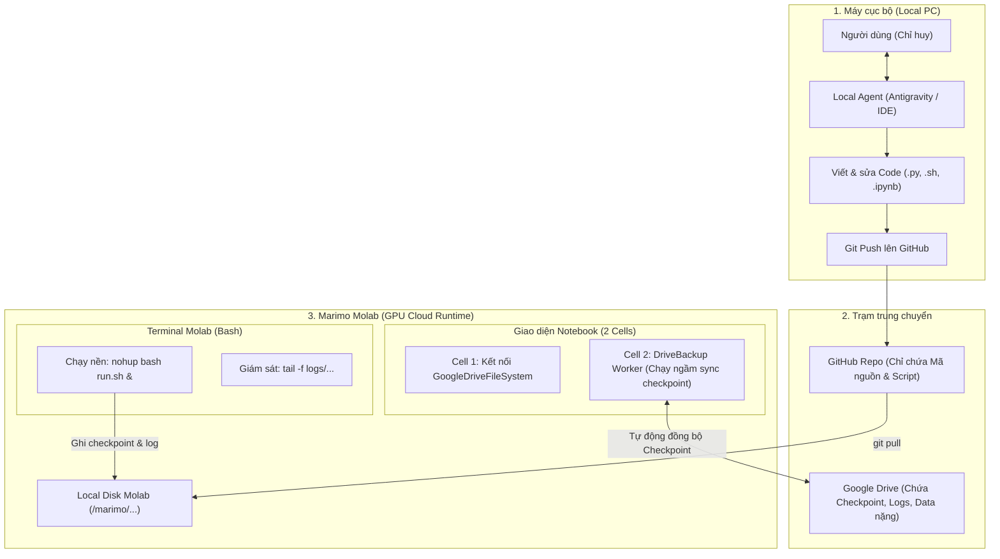

# Quy Trình Tác Chiến: Local Agent + GitHub + Marimo Molab & Google Drive

Tài liệu hướng dẫn thực chiến chuẩn hóa quy trình huấn luyện mô hình Deep Learning/ML. Tài liệu này thay thế phương thức đóng gói ZIP thủ công cũ bằng mô hình **Hybrid tối ưu**: **GitHub quản lý mã nguồn** và **Google Drive quản lý dữ liệu/checkpoint**.

---

## 1. Kiến trúc phân vai & Nguyên tắc cốt lõi



### Các nguyên tắc sống còn cần nhớ:
1. **Tuyệt đối không train vòng lặp dài bên trong Cell của Marimo**:
   - Marimo là Reactive Notebook (đồ thị phụ thuộc DAG). Chạy tác vụ train hàng giờ trong cell sẽ gây đơ giao diện, khóa kernel hoặc chết tiến trình khi rớt mạng.
   - **Cell Marimo** chỉ làm 2 việc: Kết nối Drive (`gdrive_fsspec`) và duy trì tiến trình backup checkpoint ngầm.
   - **Terminal Molab** dùng để chạy huấn luyện thực tế (`nohup bash run.sh &`).
2. **Nguyên tắc "Mỗi biến một Cell" trong Marimo**:
   - Không được định nghĩa cùng một tên biến toàn cục (như `fs`, `backup`, `workdir`) ở nhiều cell khác nhau.
3. **Phân tách ranh giới GitHub vs Google Drive**:
   - **GitHub**: Chỉ chứa code, config yaml, shell script, notebook. Tuyệt đối không commit file `.pth`, `.safetensors`, file nén zip data > 50MB.
   - **Google Drive**: Lưu trữ checkpoint mô hình (`model-last.pth`, `model-best.pth`), log huấn luyện và dữ liệu tải về.

---

## 2. Vòng lặp phát triển 4 bước (Daily Workflow)

### Bước 1: Phát triển & Chỉnh sửa trên máy cục bộ (Local Agent)
Bạn không cần tự gõ code thủ công. Hãy giao việc cho Local Agent:
* *Yêu cầu Agent*: Viết thêm module, tinh chỉnh hyperparameter trong file cấu hình, refactor code từ notebook ra script `.py` thuần.
* *Yêu cầu Agent chạy sanity test*: Chạy test cú pháp, CPU dry-run một vài step để đảm bảo code không có bug ngớ ngẩn trước khi đẩy lên GPU.
* *Đẩy code lên GitHub*:
  ```bash
  git add .
  git commit -m "feat: cap nhat pipeline vocos va learning rate"
  git push origin main
  ```

---

### Bước 2: Thiết lập & Đồng bộ mã nguồn trên Molab (Terminal)

Mở tab **Terminal** trên Molab:

#### A. Lần đầu tiên vào phiên làm việc Molab:
```bash
# Clone repo về thư mục làm việc của Molab
git clone https://github.com/<username>/<repo_name>.git
cd <repo_name>

# Cài đặt các thư viện cần thiết (nếu có requirements)
pip install -r requirements.txt
```
*(Nếu là repo Private, dùng Token: `git clone https://<GH_TOKEN>@github.com/<username>/<repo_name>.git`)*

#### B. Những lần sau (khi vừa bảo Agent local sửa code xong):
Chỉ cần đúng 1 lệnh để kéo code mới nhất trong 3 giây:
```bash
git pull
```

---

### Bước 3: Thiết lập Sao lưu tự động lên Drive (Marimo Notebook)

Mở giao diện **Notebook** của Molab và tạo đúng **2 Cell** sau:

#### Cell 1: Kết nối Google Drive qua `gdrive_fsspec`
*(Chỉ chạy 1 lần per session, hoàn thành luồng xác thực Google nếu được yêu cầu)*
```python
import marimo as mo
from gdrive_fsspec import GoogleDriveFileSystem

fs = GoogleDriveFileSystem(
    root_file_id="<ID_THƯ_MỤC_DRIVE_CỦA_BẠN>",  # ID thư mục trên Google Drive
    use_listings_cache=False,
    skip_instance_cache=True,
    auth_kwargs={"use_local_webserver": False},
)
mo.output.clear_console()
```

#### Cell 2: Khởi động Worker Auto-Backup Checkpoint
```python
import sys as _sys
from pathlib import Path as _Path

_work_dir = _Path("/marimo/<repo_name>")  # Hoặc đường dẫn thư mục làm việc thực tế
_sys.path.insert(0, str(_work_dir / "tools"))

from drive_backup import DriveBackup as _DriveBackup

# Khởi tạo backup worker quét định kỳ mỗi 120s
backup_worker = _DriveBackup(
    fs=fs,
    work=_work_dir,
    remote_root="runs/s2st_experiment_01",  # Tên folder sẽ tạo trên Google Drive
    interval=120,                           # 2 phút quét 1 lần
)
backup_worker.start()
print("✓ Drive Backup Worker is RUNNING in background.")
```

> [!IMPORTANT]
> Worker này chạy bằng một luồng ngầm trong kernel Marimo. Cứ mỗi 2 phút, nếu file `model-last.pth` hoặc `model-best.pth` có cập nhật mới, nó sẽ tự động đẩy bản copy an toàn lên Google Drive theo cơ chế xoay vòng 2 slot (`slot-0` và `slot-1`).

---

### Bước 4: Khởi chạy huấn luyện & Giám sát (Terminal)

Quay lại tab **Terminal** của Molab:

#### 1. Chạy Smoke Test (Kiểm tra nhanh GPU, CUDA, 1-step forward/backward):
```bash
python smoke_test_stage1_vocos.py
```
*Chỉ khi smoke test in ra `ALL_TESTS_PASSED` mới bấm train thật.*

#### 2. Khởi chạy Huấn luyện chạy ngầm:
```bash
LC_ALL=C bash run_stage1_molab.sh
```
*(Bên trong `run_stage1_molab.sh` sử dụng `nohup python -u train.py > logs/train.log 2>&1 &` để tách tiến trình khỏi shell).*

#### 3. Giám sát tiến độ & GPU:
```bash
# Xem log huấn luyện thời gian thực (nhấn Ctrl+C để thoát xem mà không dừng train)
tail -f logs/train.log

# Kiểm tra trạng thái GPU
nvidia-smi
```

---

## 3. Khôi phục khi mất phiên làm việc (Session Disconnect / Resume)

Nếu Molab bị timeout, crash hoặc bạn mở phiên làm việc mới vào ngày hôm sau:

1. **Trên Terminal Molab**: Clone lại repo hoặc pull code mới:
   ```bash
   git clone https://github.com/<username>/<repo_name>.git
   cd <repo_name>
   ```
2. **Trên Marimo Notebook**:
   - Chạy **Cell 1** (Kết nối Google Drive).
   - Trong **Cell 2**, khởi tạo `backup_worker` nhưng **chưa gọi `.start()`**:
     ```python
     backup_worker = _DriveBackup(fs, work=_work_dir, remote_root="runs/s2st_experiment_01")
     # Khôi phục toàn bộ checkpoint, config, log từ Google Drive về lại máy ảo:
     backup_worker.restore_latest()
     print("✓ Restored latest checkpoint successfully!")
     # Sau khi restore xong mới bật backup lại:
     backup_worker.start()
     ```
3. **Trên Terminal Molab**: Tiếp tục huấn luyện từ checkpoint vừa khôi phục:
   ```bash
   LC_ALL=C bash run_stage1_molab.sh resume
   ```

---

## 4. File mẫu: Bộ công cụ sẵn dùng

### 4.1 Script chạy ngầm chuẩn: `run_stage1_molab.sh`
```bash
#!/usr/bin/env bash
set -euo pipefail

MODE="${1:-train}"
LOG_DIR="logs"
mkdir -p "$LOG_DIR"
PID_FILE="$LOG_DIR/train.pid"

if [ "$MODE" = "train" ]; then
    echo "Starting training in background..."
    nohup python -u train.py \
        --config configs/stage1.yaml \
        > "$LOG_DIR/train.log" 2>&1 &
    
    echo $! > "$PID_FILE"
    echo "Training started with PID $(cat "$PID_FILE"). Check logs with: tail -f $LOG_DIR/train.log"

elif [ "$MODE" = "resume" ]; then
    echo "Resuming training from checkpoint..."
    nohup python -u train.py \
        --config configs/stage1.yaml \
        --resume \
        > "$LOG_DIR/train.log" 2>&1 &
    
    echo $! > "$PID_FILE"
    echo "Training resumed with PID $(cat "$PID_FILE")."

elif [ "$MODE" = "stop" ]; then
    if [ -f "$PID_FILE" ]; then
        PID=$(cat "$PID_FILE")
        echo "Stopping process $PID..."
        kill -15 "$PID" || true
        rm -f "$PID_FILE"
        echo "Stopped."
    else
        echo "No PID file found."
    fi
fi
```

### 4.2 Script Backup Google Drive cốt lõi: `tools/drive_backup.py`
```python
import os
import time
import shutil
import threading
from pathlib import Path

class DriveBackup:
    def __init__(self, fs, work, remote_root, interval=120):
        self.fs = fs
        self.work = Path(work)
        self.remote_root = remote_root.strip("/")
        self.interval = interval
        self._running = False
        self._thread = None
        self._last_mtime = 0

    def sync_once(self, force=False):
        ckpt_path = self.work / "checkpoints" / "model-last.pth"
        if not ckpt_path.exists():
            return False

        mtime = ckpt_path.stat().st_mtime
        if not force and mtime <= self._last_mtime:
            return False

        slot = "slot-0" if int(time.time() // self.interval) % 2 == 0 else "slot-1"
        target_dir = f"{self.remote_root}/{slot}"
        
        # Đẩy checkpoint và logs
        print(f"Syncing checkpoint to Drive: {target_dir}...")
        self.fs.makedirs(target_dir, exist_ok=True)
        self.fs.put(str(ckpt_path), f"{target_dir}/model-last.pth")
        
        log_file = self.work / "logs" / "train.log"
        if log_file.exists():
            self.fs.put(str(log_file), f"{target_dir}/train.log")

        self._last_mtime = mtime
        print(f"✓ Backup COMPLETE to {slot}")
        return True

    def restore_latest(self):
        # Tự động tìm slot mới nhất trên Drive để tải về
        for slot in ["slot-0", "slot-1"]:
            remote_ckpt = f"{self.remote_root}/{slot}/model-last.pth"
            if self.fs.exists(remote_ckpt):
                dest_dir = self.work / "checkpoints"
                dest_dir.mkdir(parents=True, exist_ok=True)
                print(f"Downloading checkpoint from {remote_ckpt}...")
                self.fs.get(remote_ckpt, str(dest_dir / "model-last.pth"))
                print("✓ Restored checkpoint to local disk.")
                return True
        print("No backup found on Drive.")
        return False

    def _loop(self):
        while self._running:
            try:
                self.sync_once()
            except Exception as e:
                print(f"[DriveBackup Warning] {e}")
            time.sleep(self.interval)

    def start(self):
        if not self._running:
            self._running = True
            self._thread = threading.Thread(target=self._loop, daemon=True)
            self._thread.start()

    def stop(self):
        self._running = False
        if self._thread:
            self._thread.join(timeout=5)
```

---

## 5. Bảng tra cứu lỗi nhanh (Troubleshooting)

| Lỗi thường gặp | Nguyên nhân | Cách khắc phục |
| :--- | :--- | :--- |
| `This cell redefines variables: ...` | Trong Marimo, một tên biến toàn cục bị khai báo ở 2 cell khác nhau. | Gộp vào một cell hoặc đặt tên biến cục bộ bắt đầu bằng dấu gạch dưới `_` (ví dụ `_temp_path`). |
| `git pull` bị conflict trên Molab | Do lỡ tay sửa trực tiếp file trên Molab hoặc có file log bị track. | Chạy `git checkout .` hoặc `git stash` rồi chạy lại `git pull`. |
| Mất kết nối trình duyệt khi train | Do train trực tiếp bằng cell notebook. | Luôn dùng `nohup bash run_stage1_molab.sh &` trong tab Terminal. |
| Checkpoint quá lớn upload bị nghẽn | Đang upload trực tiếp trong main loop huấn luyện. | Lưu checkpoint atomic vào local disk trước, để `DriveBackup` ngầm upload luân phiên. |
| `CUDA out of memory` | Batch size hoặc độ dài audio quá lớn trên GPU. | Báo Local Agent hạ `batch_size`, tăng `gradient_accumulation_steps` rồi push lại Git. |

---

## 6. Hướng dẫn bàn giao giữa Người dùng và Agent

* **Khi bạn muốn thêm tính năng**: Nói với Local Agent sửa mã nguồn trong repo local.
* **Khi Agent hoàn thành code**: Agent sẽ commit & push lên GitHub, đồng thời cung cấp cho bạn câu lệnh `git pull` và lệnh chạy tương ứng.
* **Bạn chỉ cần**: Mở Molab -> `git pull` -> Bật 2 cell Marimo -> Chạy lệnh Terminal. Mọi thứ còn lại được tự động hóa hoàn toàn.

